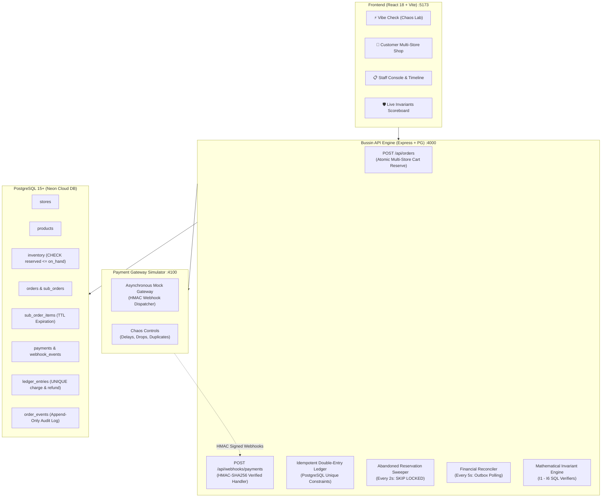

# Bussin

> **"Orders so reliable, it's bussin."**

Bussin is a production-grade multi-store payments and order fulfilment engine built for **Nexhack 2.0 (PS04 FinTech)**. When a single purchase is fulfilled by several independent stores, Bussin acts as the unified coordination and financial ledger layer. It guarantees zero overselling during high-concurrency flash sales, provides idempotent webhook processing for asynchronous payment gateways, coordinates partial refunds when individual stores fail midway, and continuously evaluates mathematical invariants across inventory and money.

---

## 🏛 Architecture & Invariants



### The 6 Core Invariants (Continuous Mathematical Proof)

| Invariant | Name | Guarantee |
|---|---|---|
| **I1** | **Stock Bounds** | For every inventory record: `0 <= reserved <= on_hand`. |
| **I2** | **Reservation Integrity** | `reserved` equals exactly the sum of `qty` of `ACTIVE` + `COMMITTED` items. |
| **I3** | **Stock Conservation** | `initial_stock = on_hand + Σ FULFILLED qty` (zero lost or phantom units, zero overselling). |
| **I4** | **Single Charge & Refund** | At most one `CHARGE` per master order and one `REFUND` per sub-order (enforced via partial unique indexes). |
| **I5** | **Money Conservation** | Per order: `Σ CHARGE − Σ REFUND` equals the exact sum of sub-orders remaining `PAID`. |
| **I6** | **Zero Orphan States** | No `PAID` sub-order without a `CHARGE`; no `REFUNDED` sub-order without a `REFUND` ledger entry. |

---

## ⚡ Quick Start & Verification

### 1. Requirements
- Node.js 20+ (developed on Node v25)
- PostgreSQL 15+ (configured with Neon serverless connection string in `.env`)

### 2. Run the Full Stack
```bash
# Install monorepo dependencies
npm install

# Run database migrations and seed initial data
npm run migrate
npm run seed

# Start all three services (API, Payment Simulator, and Web UI)
npm run dev --workspaces
```

- **Web UI & Chaos Lab:** [http://localhost:5173](http://localhost:5173)
- **API Engine:** [http://localhost:4000](http://localhost:4000)
- **Payment Simulator:** [http://localhost:4100](http://localhost:4100)

### 3. Run Automated Integration Tests
```bash
npm test --workspace=apps/api
```
All 5 scenario test suites (`S1`, `S2`, `S3`, `S4`, and `I1-I6 Invariants`) run with 100% green passing status.

---

## 🎬 5-Minute Judge Demo Script

1. **Open the Chaos Lab ("Vibe Check"):**
   Navigate to [http://localhost:5173](http://localhost:5173). Observe the **Live Invariant Panel** at the top showing all 6 mathematical invariants green.
2. **Execute S1 (Flash Sale Concurrency):**
   - Click **"⚡ Run S1 Flash Sale"**.
   - 50 concurrent buyers execute simultaneous checkout requests via `Promise.all` for the scarce `sku-flash` (stock: 10).
   - **Result:** Exactly 10 orders succeed (HTTP 201), exactly 40 get `OUT_OF_STOCK` (HTTP 409), 0 oversold, all invariants green.
3. **Execute S2 (Abandoned Reservations):**
   - Click **"⏱ Run S2 Abandoned Sweeper"**.
   - 5 reservations created with 10s TTL. Nobody pays. The sweeper automatically releases stock and cancels orders.
4. **Execute S3 (Duplicate Webhooks):**
   - Click **"🔁 Run S3 Duplicate Webhooks"**.
   - Simulator dispatches 5 duplicate `payment.captured` webhooks.
   - **Result:** Exactly 1 `CHARGE` is recorded in the ledger; 4 duplicate attempts are logged in the order's timeline audit.
5. **Execute S4 (Store Failure Mid-Order):**
   - Click **"💥 Run S4 Store Failure"**.
   - A 3-store split order is paid. Store A dispatches, Store B accepts, Store C goes offline (`DOWN`).
   - **Result:** Store C's part is cancelled and refunded; Store A's dispatched goods are untouched; Store B continues normally.
6. **Inspect Staff Console & Timeline:**
   - Switch to the **📋 Staff Console** tab. Click the split order to view the per-part state chips (Payment State + Fulfilment State) and the append-only event timeline.
